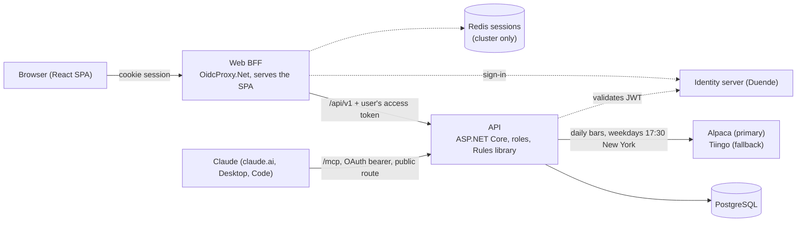

# Swing Trade

A personal swing-trading journal and screener. It replaces an Excel workbook: it stores trades and settings, downloads daily prices every weekday evening, and applies fixed, deterministic rules (20 and 50 day averages, Trend, Signal, position sizer, trade math, wash-sale flags, dashboard) so nobody types in a price. One owner, long-only US-listed ETFs, about an hour a week.

- **No AI at runtime.** Every number comes from the pure `Rules` library. The one AI touchpoint is a hosted, authenticated MCP endpoint (`/mcp`) so your own Claude can read the journal and help review it.
- **Informational, not advice.** Signals and wash-sale flags are tools for the owner; tax treatment is for a tax professional.
- **Nothing is hard-coded.** Every threshold lives in the Settings table and is editable in the UI. A threshold change applies on the next request (Trend and Signal are derived on read).

## Architecture



The browser never holds a token; the BFF does. The API is the only enforcement point: access is by role (`swingtrade.reader`, `.trader`, `.admin`, and `.mcp` for Claude), a valid token without a role gets 403. Only `/mcp` and the OAuth metadata are routed on a dedicated MCP hostname (`swingtrade-mcp.<host>`, DECISIONS #115); the UI and REST API are on the UI hostname behind login and roles, and the BFF never proxies `/mcp`.

## Project layout

| Path | What |
| --- | --- |
| `src/api/src/Spydersoft.SwingTrade.Rules` | Pure library, no I/O: indicators, trend, signal, sizer, trade math, wash sale, dashboard. The workbook fixtures are its tests |
| `src/api/src/Spydersoft.SwingTrade.Data` | EF Core entities, `DbContext`, migrations, seeder (PostgreSQL) |
| `src/api/src/Spydersoft.SwingTrade.MarketData` | Provider layer: Alpaca, Tiingo, deterministic fake, fallback and retry |
| `src/api/src/Spydersoft.SwingTrade.Contracts` | DTOs |
| `src/api/src/Spydersoft.SwingTrade.Api` | Host: controllers, services, refresh job, MCP server, health checks |
| `src/api/src/*.UnitTests` | NUnit 4 on Microsoft.Testing.Platform |
| `src/api/tests/api-integration` | Playwright API suite (request context) against the Aspire `Testing` stack |
| `src/web/src/Spydersoft.SwingTrade.Frontend` | ASP.NET BFF that serves the SPA and proxies `/api/v1` |
| `src/web/src/swing-trade-ui` | React 19, Vite, React Aria Components, Tailwind, Redux Toolkit, generated API client |
| `src/web/tests/web-integration` | Playwright browser suite against the same stack |
| `src/Spydersoft.SwingTrade.AppHost` | .NET Aspire AppHost: Postgres, mock OIDC, WireMock, API, BFF, Vite |
| `charts/swing-trade` | Helm chart (bjw-s `common`): `api` and `web` controllers, UI route on `swingtrade.<host>`, MCP route on `swingtrade-mcp.<host>` |
| `scripts/` | `build-images.sh` / `build-images.ps1` |
| `.devops/pipeline-ci.yml` | Azure DevOps pipeline |
| `docs/` | Plan, decisions, operations, identity setup (see the list at the end) |

The deployment configuration lives in the sibling repo `swing-trade-helm-config` (helmfile, environments, Postgres and ExternalSecrets).

## Quick start (fresh clone, one command)

There is no docker-compose file. Locally the .NET Aspire AppHost starts everything (DECISIONS #4); in the cluster it is Helm.

**Prerequisites**

- .NET 10 SDK (`global.json` pins 10.0.100, roll forward to the latest minor).
- Node 24 with corepack (`corepack enable`, which provides Yarn 4). The first run builds the React app.
- A container runtime for Postgres and the mock identity server: Docker, or podman with `ASPIRE_CONTAINER_RUNTIME=podman`.
- Access to the `spydersoft` NuGet feed in `src/nuget.config` (GitHub Packages needs a token with `read:packages`, for `Spydersoft.Platform.Hosting`). Configure it once: `dotnet nuget update source spydersoft --username <you> --password <PAT> --store-password-in-clear-text`.

**Start**

```sh
git clone git@github.com:spydersoft-consulting/swing-trade.git
cd swing-trade
corepack enable
yarn install        # installs the UI workspace (skippable: the first build runs it as well)
dotnet run --project src/Spydersoft.SwingTrade.AppHost --launch-profile Local
# podman:  ASPIRE_CONTAINER_RUNTIME=podman dotnet run --project src/Spydersoft.SwingTrade.AppHost --launch-profile Local
```

The first start pulls the Postgres and mock-OIDC images and builds the SPA, so allow a few minutes. The console prints a link to the Aspire dashboard.

**URLs and ports**

| What | URL |
| --- | --- |
| The app (BFF serving the built SPA) | http://localhost:8190 |
| The app with hot reload (Vite) | http://localhost:5290 |
| API | http://localhost:8180 (`/livez`, `/readyz`, `/openapi/v1.json`) |
| Mock identity server | http://localhost:8210 |
| Aspire dashboard | http://localhost:8400 (https 8401; use the login link printed in the console) |
| Postgres | host port is assigned by Aspire, see the dashboard |

The ports sit in the 81xx to 84xx block so the stack can run next to PitStop's.

**Sign in.** Local uses a mock OIDC server (no real identity provider, no secrets). Password for every user is `Test123!`:

| User | Role | What it can do |
| --- | --- | --- |
| `reader` | `swingtrade.reader` | Read everything: watchlist, trades, dashboard, notes, settings, refresh history, the sizer (a pure calculation), CSV export. No write buttons |
| `trader` | `swingtrade.trader` | Reader plus create, edit, fill, close, cancel and delete trades, add notes and passes, add and deactivate tickers |
| `admin` | `swingtrade.admin` | Trader plus change Settings, press **Refresh now**, see the MCP panel and call log |
| `norole` | none | Signs in and sees "Access not granted" (the API answers 403) |
| `mcponly`, `mcpother` | `swingtrade.mcp` | For `/mcp` only (`mcponly` is the configured owner). Not REST users |

Use `admin` to see everything.

**Data on the first run.** The Local profile uses the deterministic fake market-data provider (no keys). The database is seeded (Settings defaults, the 12 active and 12 inactive tickers, and one closed XLE trade), and because `Refresh:RunOnStartupWhenEmpty` is on in Development, the API runs one refresh at its first start when no price bars exist, so the Watchlist is populated right away (DECISIONS #102). It is off in `appsettings.json`, so a deployment never refreshes at start. To reload at any time, sign in as `admin` and press **Refresh now** on the Watchlist, or call `POST /api/v1/refresh` (Admin). Mint a token for curl:

```sh
TOKEN=$(curl -s http://localhost:8210/connect/token \
  -d grant_type=password -d client_id=swingtrade-api-test -d client_secret=swingtrade-api-test-secret \
  -d username=admin -d password='Test123!' -d scope=swingtrade | sed 's/.*"access_token":"\([^"]*\)".*/\1/')
curl -X POST -H "Authorization: Bearer $TOKEN" http://localhost:8180/api/v1/refresh     # 202; poll /api/v1/refresh/runs
curl -H "Authorization: Bearer $TOKEN" http://localhost:8180/api/v1/watchlist
```

Postgres keeps a data volume, so state survives restarts. To start from scratch, stop the AppHost and remove the volume (`docker volume ls`, then `docker volume rm <name>`). If a run was killed rather than stopped, leftover containers can hold the ports: list and remove them (`docker ps -a` / `podman ps -a`, then `rm -f`).

## Tests

```sh
dotnet build Spydersoft.SwingTrade.slnx
dotnet test Spydersoft.SwingTrade.slnx                    # unit tests: Rules fixtures, services, MCP, auth, health checks
cd src/web/src/swing-trade-ui && yarn test-ci && yarn lint   # UI: Vitest and ESLint/Prettier

# End-to-end suites. Each one boots the AppHost "Testing" profile (Postgres, mock OIDC, WireMock for Alpaca and Tiingo,
# API, BFF) through Playwright's webServer, so a container runtime is required. Stop any running Local stack first
# (they use the same ports).
cd src/api/tests/api-integration && corepack enable && yarn install && yarn test     # API: request context, role matrix, MCP
cd src/web/tests/web-integration && corepack enable && yarn install && npx playwright install chromium && yarn test   # browser
```

With podman, export `ASPIRE_CONTAINER_RUNTIME=podman` first. On Windows, Playwright stops only the `dotnet` process, so remove leftover containers between runs.

## Real market data (Alpaca, Tiingo)

Local uses the fake provider. To try real prices, give the API keys through user-secrets (never committed) and select the providers; the step-by-step check, including how to compare averages with a broker chart, is `docs/M3_MANUAL_CHECK.md`:

```sh
dotnet user-secrets set "MarketData:Alpaca:KeyId" "<key id>"        --project src/api/src/Spydersoft.SwingTrade.Api
dotnet user-secrets set "MarketData:Alpaca:SecretKey" "<secret>"    --project src/api/src/Spydersoft.SwingTrade.Api
dotnet user-secrets set "MarketData:Tiingo:Token" "<token>"         --project src/api/src/Spydersoft.SwingTrade.Api   # optional fallback
```

Then set `MarketData__Providers__0=alpaca` (and `__1=tiingo`) on the API resource. Provider choice and terms: `docs/MARKET_DATA_OPTIONS.md`.

## Claude and MCP

The API hosts a Streamable HTTP MCP server at `/mcp` (OAuth 2.0 through the identity server, owner-only, read-only tools, the `journal://rules` resource and two prompts). Locally the `mcponly` mock user is the owner. For the real deployment follow `docs/IDENTITY_SETUP.md` (two Duende clients, the Claude connector settings, the public route) and the MCP checklist in `docs/OPERATIONS.md`. Tool and security details are in `src/api/README.md`.

## Containers and deployment

CI publishes the projects first and the Dockerfiles only `COPY . /app` (as PitStop does). To build both images locally the same way:

```sh
scripts/build-images.sh [tag]                    # CONTAINER_CLI=podman to force podman
pwsh scripts/build-images.ps1 -Tag local -Cli podman
```

This produces `swing-trade-api:<tag>` and `swing-trade-web:<tag>` (each listens on 8080, non-root, `/livez` and `/readyz`). The API image needs `ConnectionStrings__swingtrade-db`, `Auth__Authority`, `Mcp__PublicUrl`, `Mcp__OwnerSubject` and a provider (`MarketData__Providers__0`). The Helm chart is `charts/swing-trade` (see its README for the secrets contract) and the environments are in `swing-trade-helm-config`. Operations (first deploy, backup, rotation, troubleshooting) are in `docs/OPERATIONS.md`.

## Documentation

| Doc | What |
| --- | --- |
| `docs/BUILD_PLAN.md` | The spec: formulas, data model, API, screens, tests, milestones |
| `docs/DECISIONS.md` | Every decision, with status, and the open items for the owner |
| `docs/OPERATIONS.md` | First deploy, backup and restore, MCP exposure, refresh troubleshooting, rotation, limits |
| `docs/IDENTITY_SETUP.md` | Identity-server changes: roles, API resource, BFF and Claude clients, public route |
| `docs/REFERENCE_NOTES.md` | How the reference app (PitStop) is built and what is mirrored |
| `docs/apphost-launch-profiles.md` | `Local` and `Testing` profiles, ports, mock users |
| `docs/M3_MANUAL_CHECK.md` | Checking real Alpaca and Tiingo data against a broker chart |
| `docs/MARKET_DATA_OPTIONS.md` | Provider research and terms |
| `src/api/README.md`, `src/web/README.md` | API and web details |
| `charts/swing-trade/README.md` | Chart values and secrets contract |
| `CONTRIBUTING.md` | Workflow, conventions, tests |

## License

MIT, see `LICENSE`.
